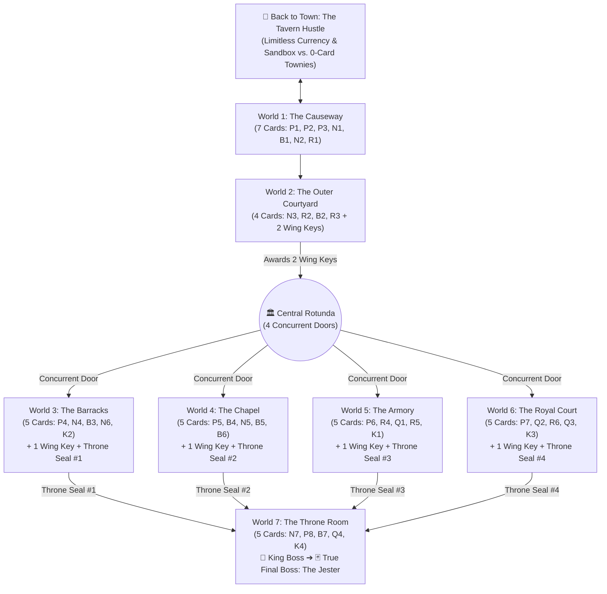

# STORYBOARD.md — Campaign Narrative, 36-Card Pyramid & 7-World Castle Architecture

> **Milestone**: v3.0 Parallel World Key Campaign, 36-Card Pyramid & Grandmaster Trials
> **Status**: Locked (`[DECISION-025]`, `[DECISION-026]`, `[DECISION-027]`)

---

## 1. Narrative Premise & Living Chess Piece Cast

### 1.1 Everyone Is a Living Chess Piece
All characters in cutscenes, on the campaign map, in the Town Tavern, and on the board are expressive, physical **living chess pieces**:
- **The Player (You)**: An unpainted, rough-hewn wooden **Pawn** from the outskirts of town—ordinary on the outside, which is why the Castle guards underestimate you.
- **The Scheming Jester**: A crooked, mismatched **Fairy/Jester Piece** wearing a tattered fool's cap. Years ago, when the board was **9×9**, the Jester was a legal royal piece on the 9th file and authored a legendary **36-Page Secret Playbook** of unorthodox chess maneuvers. When the **Iron King** decreed the *"Great Standardization"*—sawing the 9th file and 9th rank off every board in the kingdom to enforce strict **8×8 Orthodox Chess**—the Jester was declared an illegal piece and banished on sight. Worse, the King confiscated the Jester's 36-Page Playbook and handed the pages out to his **Castle Captains and Wing Commanders** so only the Royal Guard could break the rules.
- **Towny Characters (`The Tavern`)**: Friendly, everyday wooden and stone chess pieces in town (*The Woodcarver Pawn, The Blacksmith Rook, The Innkeeper Knight, The Town Mayor King*) who only know standard 8×8 chess.
- **Castle Guards & Lieutenants**: Iron-helmed Pawns, visored Warhorse Knights, stained-glass Mitred Bishops, castellated Stone Rooks, and gilded Royal Commanders who guard the Castle Wings and actively play stolen Playbook cards against you.

### 1.2 The Hook & The Final Twist
1. **Act I — The Tavern Test**: In the Town Tavern, a hooded figure (the Jester) sets up a seemingly impossible board position to find someone clever enough to see beyond standard rules. When you solve it, he slips you **Page 1 (`P1 — Sidestep`)** and recruits you as his unassuming proxy to infiltrate the Castle and steal back all 36 pages of his Playbook.
2. **Act II — Storming the Castle & Concurrent Wings**: You cross **The Causeway (`World 1`)** and breach **The Outer Courtyard (`World 2`)** to enter the **Central Rotunda**, where **4 Castle Wings (`Worlds 3, 4, 5, 6`)** branch out concurrently. You unlock Wings in any order with **Wing Keys**, defeating the Officers and Wing Bosses to collect all **4 Heavy Throne Room Seals**.
3. **Act III — The Throne Room & The Jester's Double-Cross (`World 7`)**: You unseal **The Throne Room**, defeat the **Royal Guard**, and best **The Iron King** himself to claim the 36th and final page (`K4 — Banish`). The moment you hand the completed 36-Page Playbook to the Jester, **he double-crosses you**—revealing he never wanted to destroy the Playbook or restore freedom to the board; he wanted his complete 36-card arsenal back to seize the Crown for himself.
4. **The True Final Boss**: You face **The Scheming Jester** in a full-board 8×8 Grandmaster showdown where our custom **Card-Aware Minimax AI** wields a master deck against your 36-card collection.

---

## 2. Global Engine Rules & Precision Invariants

1. **Unified Action Model ("1 Card Per Turn" / Energy Backburnered)**:
   - Active Energy (`⚡`) costs are backburnered for Release 1.
   - On your turn, you either make a **Standard Chess Move** OR play **1 Card Move** whose board condition is satisfied (*"The Card IS the Move"*).
2. **Pure Board-Geometry Conditions**:
   - Zero temporary terrain walls/shields and zero "unmoved piece / starting-square" conditions. Every card condition is evaluated purely from current board coordinates and piece relationships.
3. **Rank 1 (Home Back-Rank) Pawn Legalization**:
   - Friendly Pawns may legally exist on Rank 1 (`a1–h1` relative to owner) via card effects (`K1 — Conscription`, `K4 — Banish`).
   - A Pawn on Rank 1 may step 1 square forward onto Rank 2 (no 2-square jump from Rank 1, no *en passant*).
   - Any Pawn on Rank 2 (`a2–h2`) may step 1 or 2 squares forward.
   - `DeckChessEngine.ts` passes `{ skipValidation: true }` to `chess.load(fen, { skipValidation: true })`.
4. **Rank 8 Instant Promotion Invariant**:
   - Any card effect that moves, pushes, pulls, swaps, or spawns a Pawn onto its promotion rank (`Rank 8` for White, `Rank 1` for Black) immediately promotes that Pawn.
5. **Bishop Color-Complex Switching Relaxed**:
   - Bishops may switch square colors when moved orthogonally or onto a new square via `B4 (Change Color)`, `R5 (Catapult)`, or `K3 (Royal Execution)`.
6. **Pawn Spawning Config Flag (`limitPawnsTo8: boolean`)**:
   - Only 4 cards in the entire 36-card pyramid spawn Pawns (`P8`, `N7`, `R6`, `K1`).
   - The engine supports `limitPawnsTo8: boolean` to toggle between Graveyard-limited (`pawnsOnBoard < 8`) and Unlimited Pawn spawning.

---

## 3. Castle Map Architecture & Concurrent Wing Progression

### 3.1 Summary of the 7 Worlds (Option B Semi-Themed Balance)

| World | Castle Location | Theme & Boss | Cards Unlocked (In Order) | Keys / Milestones Awarded |
| :--- | :--- | :--- | :--- | :--- |
| **Town** | **The Town Tavern** | Sandbox vs. Townies (0-Card Standard Chess Bots) | *Uses your unlocked cards* | Endless **Gold Coins** |
| **World 1** | **The Causeway** | Outer Bridge & Gatehouse Captain (`Rook`) | `P1` → `P2` → `P3` → `N1` → `B1` → `N2` → **Boss `R1`** (`7 Cards`) | Unlocks **Slot 2** (mid-W1), **Slot 3** & **Courtyard Key** (Boss) |
| **World 2** | **Outer Courtyard** | Parade Grounds Commander (`Rook`) | `N3` → `R2` → `B2` → **Boss `R3`** (`4 Cards`) | Awards **2 Wing Keys** to open any 2 Concurrent Wings (`W3–W6`) |
| **World 3** | **The Barracks** *(Concurrent)* | Cavalry Wing + Swapped Bishop (`Knight Boss`) | `P4` → `N4` → `B3` → `N6` → **Boss `K2`** (`5 Cards`) | Mid-Wing: **+1 Wing Key**; Boss: **Throne Seal #1** |
| **World 4** | **The Chapel** *(Concurrent)* | Cloister Wing + Swapped Knight (`Bishop Boss`) | `P5` → `B4` → `N5` → `B5` → **Boss `B6`** (`5 Cards`) | Mid-Wing: **+1 Wing Key**; Boss: **Throne Seal #2** |
| **World 5** | **The Armory** *(Concurrent)* | Siege Wing + Swapped Queen (`Rook Boss`) | `P6` → `R4` → `Q1` → `R5` → **Boss `K1`** (`5 Cards`) | Mid-Wing: **+1 Wing Key**; Boss: **Throne Seal #3** |
| **World 6** | **The Royal Court** *(Concurrent)* | Gallery Wing + Swapped Rook (`Queen Boss`) | `P7` → `Q2` → `R6` → `Q3` → **Boss `K3`** (`5 Cards`) | Mid-Wing: **+1 Wing Key**; Boss: **Throne Seal #4** |
| **World 7** | **The Throne Room** | Inner Sanctum (`The Iron King` → `The Jester`) | `N7` → `P8` → `B7` → `Q4` → **King Boss `K4`** → **Final Boss: The Jester** (`5 Cards`) | Completes 36-Card Playbook & Unlocks **World 8+ Atlas Frontier** |

> **Slot Unlock Milestones (Order-Independent across Concurrent Wings)**:
> - **Start of W1**: `1 Card Slot`
> - **After 3rd Card of W1 (`P3`)**: `2 Card Slots`
> - **Beat W1 Boss (`R1`)**: `3 Card Slots`
> - **Beat Your First Concurrent Wing Boss (1st Throne Seal)**: `4 Card Slots`
> - **Beat Your Third Concurrent Wing Boss (3rd Throne Seal)**: `5 Card Slots`
> - **Optional Shop Upgrade ("Up Your Sleeve")**: `+1 Bonus Card Slot` (up to `6 Card Slots` max)

---

## 4. The 3-Step Card Cycle & Forced-Slot Rule

Every card `C_n` in an area follows a tight **2–3 puzzle cycle**:

1. **Step 1 — Foreshadow Puzzle 1 (`Forced-Slot Mastery of Previous Card`)**:
   - The enemy Officer actively plays the new card `C_n` against you so you see its Condition and Effect in action before owning it.
   - **Forced-Slot Rule**: If `C_n` is *not* the first card of an area, **1 of your hand slots is automatically locked to `C_{n-1}` (the card you just won in the previous duel)** for **this single puzzle only**, ensuring you immediately test-drive your newly won card once while your remaining slots are free choice.
2. **Step 2 — Foreshadow Puzzle 2 *(Optional for complex cards)***:
   - A second tactical encounter where the Officer uses `C_n` in a deeper setup. All of your hand slots are 100% free choice.
3. **Step 3 — Officer Duel (`Unlock Card C_n`)**:
   - Defeat the Officer/Commander to tear page `C_n` out of their hands and add it permanently to your Playbook.
   - **Area Finale Exception**: For the **final Boss card of each World (`R1, R3, K2, B6, K1, K3, K4`)**, there is **no forced-slot puzzle afterward**, because the area concludes immediately after the Boss duel and the player returns to the Central Rotunda / Map (or in World 7, enters the True Final Boss duel against the Jester with full free-choice access to all 36 cards).

---

## 5. "Back to Town" (The Tavern Hustle) & The Jester's Coat Shop

### 5.1 "Back to Town" — Limitless Currency & Sandbox Mode
At any point during the campaign, the player can click **"🍺 Back to Town (The Tavern)"** on the map to step away from Castle puzzles and play full 8×8 games against **Towny Characters**:
- **How It Works**: Towny opponents play **pure standard 8×8 chess (0 cards)** at selectable/escalating skill tiers, while **the player brings their full unlocked hand of cards**.
- **The Cast of Townies**:
  1. **Barnaby the Woodcarver (`Pawn` — ~600 ELO)**: Casual tavern regular; great for testing brand-new card combos and earning quick Gold Coins.
  2. **Greta the Innkeeper (`Knight` — ~950 ELO)**: Scrappy tactical player who loves knight forks.
  3. **Bram the Blacksmith (`Rook` — ~1300 ELO)**: Solid positional player who controls open files.
  4. **Mayor Aldric (`King` — ~1650 ELO)**: The Town Chess Champion; plays sharp orthodox chess and pays out the largest Gold Coin purse.
- **Future Multiplayer Hook**: When Multiplayer progression is wired, completing PvP games will also award Gold Coins, while **PvP Duplicate Copies** will be unlocked exclusively through **Multiplayer Mastery Challenges** (performing specific card feats in online matches).

### 5.2 The Jester's Coat Shop (Gold Coin Upgrades)
Between matches, players can spend **Gold Coins** at the Jester's Coat on **4 streamlined, high-utility upgrades** (no Mulligan or Loaded Draw since players bring a fixed hand without random deck drawing):

| Shop Item | Narrative Flavor | Mechanical Effect & Implementation |
| :--- | :--- | :--- |
| **1. Jester's Distraction (`Rewind 1 Turn`)** | The Jester points out the window and yells *"Look, the King!"*, sliding the last turn's pieces back while the guard blinks. | Consumable token (up to 3 per match). Pops the last full turn (`opponent move + player move`) from `DeckChessEngine` FEN/hand state history. |
| **2. Jester's Whisper (`Engine Hint`)** | The Jester leans in from the shadows and whispers which piece or card creates an opening. | Consumable token. Queries the puzzle's `recommendedCardId` tag or runs a 2-ply evaluation on our custom card-aware engine, highlighting the best card/piece in gold. |
| **3. Carbon Copy (`Campaign Duplicate`)** | The Jester uses stolen royal ink to forge an extra copy of any card you've already unlocked. | Unlocks an additional copy (+1 per purchase) of a specific unlocked card for use in **Campaign & Tavern** hands. |
| **4. "Up Your Sleeve" (`+1 Bonus Card Slot`)** | The Jester stitches a hidden pocket inside your cloak so you can sneak one extra card onto the board. | One-time permanent upgrade adding **+1 Bonus Hand Slot** on top of the baseline slots earned from World Bosses. |

---

## 6. World-by-World & Card-by-Card Master Storyboard (All 36 Cards)

### World 1: The Causeway (`7 Cards: 3P, 2N, 1B, 1R`)
*Setting: The cobblestone bridge leading from the Town Tavern to the Castle's outer portcullis.*

| Order | Code | Card Name | Piece | Condition | Effect | Cycle Notes |
| :---: | :---: | :--- | :---: | :--- | :--- | :--- |
| **1** | `P1` | **Sidestep** | ♟ Pawn | Pawn has any piece directly in front. | Step 1 square diagonally forward onto an empty square. | Guided Tavern + Bridge intro (1 Slot). |
| **2** | `P2` | **Attack Head On** | ♟ Pawn | Enemy Pawn is directly in front of this Pawn. | Capture that enemy Pawn straight ahead. | Puzzle 1 auto-slots `P1`. |
| **3** | `P3` | **March Together** | ♟ Pawn | Two friendly Pawns are horizontally adjacent with empty squares directly in front. | Advance both friendly Pawns 1 square straight forward together. | Puzzle 1 auto-slots `P2`. Unlocking `P3` awards **Slot #2**. |
| **4** | `N1` | **Adrenaline Jump** | ♞ Knight | This Knight is currently under attack by an enemy piece. | Jump 3 squares in one orthogonal direction and 1 square perpendicular (`3×1` Camel-like jump, move or capture). | Puzzle 1 auto-slots `P3`. |
| **5** | `B1` | **Let Me Through** | ♝ Bishop | Friendly Pawn sits on this Bishop's unobstructed forward diagonal. | Slide cleanly through that friendly Pawn to any unobstructed square beyond. | Puzzle 1 auto-slots `N1`. |
| **6** | `N2` | **Springboard** | ♞ Knight | Friendly piece occupies one of this Knight's L-jump squares. | Bounce off friendly piece to make a second full L-jump (move or capture). | Puzzle 1 auto-slots `B1`. |
| **7 (Boss)** | `R1` | **Make Way** | ♜ Rook | Friendly Pawn is orthogonally adjacent and has an empty square perpendicular to your line. | Pawn steps aside perpendicular to an empty square, and Rook slides to any open square along the opened line. | Puzzle 1 auto-slots `N2`. **Gatehouse Boss**: Awards `R1`, **Slot #3**, and opens World 2 (*no forced slot after Boss*). |

---

### World 2: The Outer Courtyard (`4 Cards: 1N, 1B, 2R`)
*Setting: The stone training yard inside the gatehouse, leading up the grand steps to the Central Rotunda.*

| Order | Code | Card Name | Piece | Condition | Effect | Cycle Notes |
| :---: | :---: | :--- | :---: | :--- | :--- | :--- |
| **8** | `N3` | **Trample** | ♞ Knight | Enemy Pawn lies on the 2-square straight leg of either L-jump path. | Jump to landing square (move or capture) and destroy enemy Pawns on that leg. | All 3 slots free choice on entry. |
| **9** | `R2` | **I've Got Your Back** | ♜ Rook | Friendly non-King piece sits on same rank with square in front open or enemy. | Push friendly piece 1 square forward (move or capture) and slide Rook into vacated tile. | Puzzle 1 auto-slots `N3`. |
| **10** | `B2` | **Pierce** | ♝ Bishop | Exactly 1 enemy Pawn sits on unobstructed diagonal with squares beyond. | Destroy enemy Pawn, landing on empty square or capturing enemy beyond. | Puzzle 1 auto-slots `R2`. |
| **11 (Boss)** | `R3` | **Cut Across** | ♜ Rook | This Rook sits on one of the two 8-square main diagonals (`a1–h8` or `a8–h1`). | Step 1 square diagonally along that main diagonal (onto an empty square or to capture). | Puzzle 1 auto-slots `B2`. **Courtyard Boss**: Awards `R3` + **2 Wing Keys** to the **Central Rotunda** (*no forced slot after Boss*). |

---

### World 3: The Barracks — Concurrent Wing A (`5 Cards: 1P, 2N, 1B, 1K`)
*Setting: The vaulted cavalry stables and training ring branching off the West Door of the Central Rotunda. Commanded by the Cavalry Captain (`Knight Boss`).*

| Order | Code | Card Name | Piece | Condition | Effect | Cycle Notes |
| :---: | :---: | :--- | :---: | :--- | :--- | :--- |
| **12** | `P4` | **Attack Together** | ♟ Pawn | Pawn can capture an enemy piece diagonally ahead and has an adjacent friendly Pawn. | Capture the enemy piece and move that adjacent friendly Pawn into vacated origin square. | Free choice slots on Wing entry. |
| **13** | `N4` | **Square Jump** | ♞ Knight | Knight is defended by any friendly piece. | Jump 2 squares diagonally in any direction to move or capture. | Puzzle 1 auto-slots `P4`. |
| **14** | `B3` | **Ricochet** *(Swapped Bishop)* | ♝ Bishop | An empty square on the `a`-file or `h`-file lies along this Bishop's unobstructed diagonal. | Slide diagonally to that edge square and bounce 90° inward along the reflected diagonal any number of unobstructed squares (move or capture). | Puzzle 1 auto-slots `N4`. Unlocking `B3` awards **+1 Wing Key**. |
| **15** | `N6` | **Flanking Support** | ♞ Knight | Knight is on file a, b, g, or h and you have another friendly Knight. | Make normal Knight jump, and move other friendly Knight into vacated square. | Puzzle 1 auto-slots `B3`. |
| **16 (Boss)** | `K2` | **Royal Knighting** | ♚ King | A friendly Pawn is horizontally adjacent (1 square left or right on the same rank) to your King. | Remove that friendly Pawn to your graveyard and spawn a friendly Knight onto that exact square. | Puzzle 1 auto-slots `N6`. **Barracks Boss**: Awards `K2` + **Throne Seal #1** (*no forced slot after Boss*). |

---

### World 4: The Chapel — Concurrent Wing B (`5 Cards: 1P, 1N, 3B`)
*Setting: The candlelit stained-glass cloister branching off the East Door of the Central Rotunda. Commanded by the High Prelate (`Bishop Boss`).*

| Order | Code | Card Name | Piece | Condition | Effect | Cycle Notes |
| :---: | :---: | :--- | :---: | :--- | :--- | :--- |
| **17** | `P5` | **Get Behind Me** | ♟ Pawn | Friendly non-Pawn, non-King piece in the 3 forward squares is under attack. | Swap places with that attacked friendly piece. | Free choice slots on Wing entry. |
| **18** | `B4` | **Change Color** | ♝ Bishop | At least 1 enemy piece is orthogonally adjacent to this Bishop. | Step 1 square orthogonally onto empty square or capture adjacent enemy. | Puzzle 1 auto-slots `P5`. |
| **19** | `N5` | **Get to the King** *(Swapped Knight)* | ♞ Knight | Knight can jump to an unthreatened square that forks enemy King and another enemy piece. | Jump to safe forking square, then make an immediate second L-jump. | Puzzle 1 auto-slots `B4`. Unlocking `N5` awards **+1 Wing Key**. |
| **20** | `B5` | **Take My Place** | ♝ Bishop | This Bishop is under attack by any enemy piece. | Swap places with friendly non-King piece along unobstructed diagonal. | Puzzle 1 auto-slots `N5`. |
| **21 (Boss)** | `B6` | **Diagonal Launch** | ♝ Bishop | Friendly Pawn sits in the rank directly ahead of this Bishop. | Launch friendly Pawn along its forward diagonals to move or capture. | Puzzle 1 auto-slots `B5`. **Chapel Boss**: Awards `B6` + **Throne Seal #2** (*no forced slot after Boss*). |

---

### World 5: The Armory — Concurrent Wing C (`5 Cards: 1P, 2R, 1Q, 1K`)
*Setting: The heavy iron forge and siege-weapon hall branching off the North-West Door of the Central Rotunda. Commanded by the Siege Master (`Rook Boss`).*

| Order | Code | Card Name | Piece | Condition | Effect | Cycle Notes |
| :---: | :---: | :--- | :---: | :--- | :--- | :--- |
| **22** | `P6` | **Double Time** | ♟ Pawn | Pawn is on Ranks 3, 4, or 5 with 2 empty squares directly in front. | Advance this Pawn 2 squares straight forward. | Free choice slots on Wing entry. |
| **23** | `R4` | **Move in Unison** | ♜ Rook | Two friendly Rooks share unobstructed rank or file. | Move this Rook along line, and move second Rook into square this Rook vacated. | Puzzle 1 auto-slots `P6`. |
| **24** | `Q1` | **Royal Summons** *(Swapped Queen)* | ♛ Queen | Friendly non-King piece lies in Queen line of sight at distance >= 2. | Pull friendly piece along ray onto empty square adjacent to Queen. | Puzzle 1 auto-slots `R4`. Unlocking `Q1` awards **+1 Wing Key**. |
| **25** | `R5` | **Catapult** | ♜ Rook | Friendly piece is directly in front of Rook and enemy lies along ray beyond. | Launch front ally over open ray to capture enemy ahead (Rook stays in place). | Puzzle 1 auto-slots `Q1`. |
| **26 (Boss)** | `K1` | **Conscription** | ♚ King | King is on home back rank (Rank 1/8) with empty adjacent orthogonal square. | Spawn friendly Pawn onto each empty adjacent orthogonal square (up to 3 Pawns). | Puzzle 1 auto-slots `R5`. **Armory Boss**: Awards `K1` + **Throne Seal #3** (*no forced slot after Boss*). |

---

### World 6: The Royal Court — Concurrent Wing D (`5 Cards: 1P, 1R, 2Q, 1K`)
*Setting: The mirrored chandelier gallery branching off the North-East Door of the Central Rotunda. Commanded by Her Majesty (`The Queen Boss`).*

| Order | Code | Card Name | Piece | Condition | Effect | Cycle Notes |
| :---: | :---: | :--- | :---: | :--- | :--- | :--- |
| **27** | `P7` | **Protect the King** | ♟ Pawn | Friendly King is in this Pawn's 8 surrounding squares. | Slide this Pawn diagonally any unobstructed distance to move or capture. | Free choice slots on Wing entry. |
| **28** | `Q2` | **The Queen's Gambit** | ♛ Queen | Friendly non-King unit in Queen line of sight is under attack by enemy non-King unit. | Sacrifice friendly unit to graveyard and move Queen onto attacking enemy unit square. | Puzzle 1 auto-slots `P7`. |
| **29** | `R6` | **Garrison** *(Swapped Rook)* | ♜ Rook | Rook is orthogonally adjacent to friendly King with square in front empty. | Spawn 1 friendly Pawn onto empty square 1 rank in front of Rook. | Puzzle 1 auto-slots `Q2`. Unlocking `R6` awards **+1 Wing Key**. |
| **30** | `Q3` | **Royal Shield** | ♛ Queen | Friendly Pawn is 1 square away along ray with squares beyond. | Push Pawn along ray to target square and slide Queen 1 square behind it. | Puzzle 1 auto-slots `R6`. |
| **31 (Boss)** | `K3` | **Royal Execution** | ♚ King | Enemy in King line of sight and friendly non-King piece is adjacent to King. | Launch adjacent friendly piece directly onto enemy piece to capture it. | Puzzle 1 auto-slots `Q3`. **Royal Court Boss**: Awards `K3` + **Throne Seal #4** (*no forced slot after Boss*). |

---

### World 7: The Throne Room — Finale (`5 Cards: 1P, 1N, 1B, 1Q, 1K` + True Final Boss)
*Setting: Behind the 4-Seal Bronze Doors of the Central Rotunda. All the most explosive finisher cards in the Playbook are guarded by the Royal Guard and the Iron King himself—followed by the Jester's betrayal.*

| Order | Code | Card Name | Piece | Condition | Effect | Cycle Notes |
| :---: | :---: | :--- | :---: | :--- | :--- | :--- |
| **32** | `N7` | **Outpost Support** | ♞ Knight | Knight is on Ranks 5-8 with an empty rear-diagonal square. | Spawn a friendly Pawn onto an empty rear-diagonal square behind this Knight. | All 5 slots free choice on Throne Room entry. |
| **33** | `P8` | **Call Reserves** | ♟ Pawn | Pawn is on Ranks 5-7 with an empty rear-diagonal square. | Spawn a friendly Pawn onto an empty rear-diagonal square behind this Pawn. | Puzzle 1 auto-slots `N7`. |
| **34** | `B7` | **Bishop's Blessing** | ♝ Bishop | Friendly non-Bishop piece is in this Bishop's 8 surrounding squares. | Move adjacent ally along diagonals of its current square to move or capture. | Puzzle 1 auto-slots `P8`. |
| **35** | `Q4` | **One Fell Swoop** | ♛ Queen | Queen supported from behind by R/B/Q along shared ray with enemy units ahead. | Move Queen to end of ray, capturing every enemy unit along path in a single sweep. | Puzzle 1 auto-slots `B7`. |
| **36 (King Boss)** | `K4` | **Turncoat** | ♚ King | Enemy Pawn is in King's 8 surrounding squares. | Convert enemy Pawn in-place into friendly Pawn under your control. | Puzzle 1 auto-slots `Q4`. **Iron King Duel**: Awards `K4` (completing all 36 cards). *No forced slot after King.* |
| **FINAL** | — | **True Final Boss: The Scheming Jester** | 🃏 All | The Jester steals your completed 36-Card Playbook and challenges you on an 8×8 board with his Master Deck. | Full 8×8 Grandmaster Duel against the Card-Aware Minimax AI. | Full free-choice hand from all **36 Cards**. Victory unlocks the **World 8+ Atlas Frontier**. |

---

## 7. Verification of the 36-Card Piece-Abundance Pyramid

| Piece Class | Target Count | Locked Cards | World Distribution |
| :--- | :---: | :--- | :--- |
| ♟ **Pawn** | **8** | `P1, P2, P3, P4, P5, P6, P7, P8` | `W1 (3)`, `W3 (1)`, `W4 (1)`, `W5 (1)`, `W6 (1)`, `W7 (1)` |
| ♞ **Knight** | **7** | `N1, N2, N3, N4, N5, N6, N7` | `W1 (2)`, `W2 (1)`, `W3 (2)`, `W4 (1)`, `W7 (1)` |
| ♝ **Bishop** | **7** | `B1, B2, B3, B4, B5, B6, B7` | `W1 (1)`, `W2 (1)`, `W3 (1)`, `W4 (3)`, `W7 (1)` |
| ♜ **Rook** | **6** | `R1, R2, R3, R4, R5, R6` | `W1 (1)`, `W2 (2)`, `W5 (2)`, `W6 (1)` |
| ♛ **Queen** | **4** | `Q1, Q2, Q3, Q4` | `W5 (1)`, `W6 (2)`, `W7 (1)` |
| ♚ **King** | **4** | `K1, K2, K3, K4` | `W3 (1)`, `W5 (1)`, `W6 (1)`, `W7 (1)` |
| **TOTAL** | **36** | **36 / 36 Cards Accounted For** | `W1 (7) + W2 (4) + W3 (5) + W4 (5) + W5 (5) + W6 (5) + W7 (5) = 36` |
