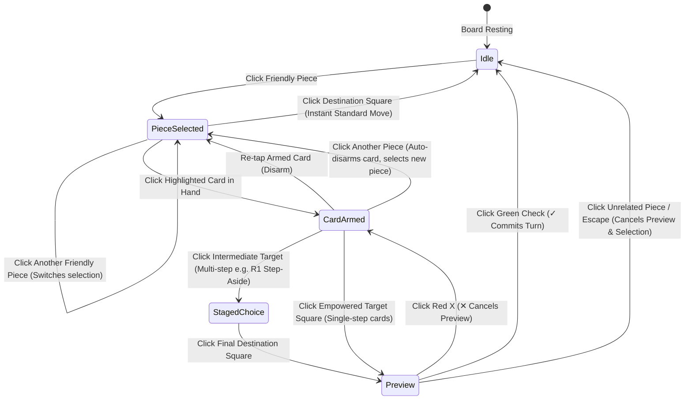

# Phase 4 Research: Gameplay Bugfixes, 36-Card Mechanics Audit & Mobile Ergonomics

> **Milestone**: v3.0 Parallel World Key Campaign, 36-Card Pyramid & Grandmaster Trials  
> **Phase**: 4 — Gameplay Bugfixes, 36-Card Mechanics Audit & Mobile Card Ergonomics  
> **Status**: Completed Research & Discovery

---

## Executive Summary

Phase 4 remediates four critical gameplay, ergonomic, and rule-implementation defects identified during private match playtesting:

1. **Piece-First Standard Move vs Forced Card Play Collision**: Clicking a piece on the board inadvertently forced an empowered card move whenever that destination square overlapped with a card ability, making normal chess moves impossible.
2. **R1 "Make Way" Mechanics Mismatch**: Card pushed the blocking pawn forward along the ray instead of perpendicular to the file, and did not open up the file for the Rook to slide freely.
3. **Mobile Card Compression**: Narrow screens (375px) squished 8-card hands horizontally into unreadable slices.
4. **Spent Card Hand Reordering**: Played cards remained in place rather than sliding to the tail of the player's tactical hand.

---

## 1. Architectural Analysis: Turn Flow & Selection State Machine

### 1.1 Root Cause in `useDeckChessGame.ts`
In `handleSquareClick(square)`:
```typescript
// Lines 623-639 in useDeckChessGame.ts:
const matchingEmpowered = empoweredMovesForSelected.filter((m) => m.to === square);
if (matchingEmpowered.length > 0) {
  // Triggers setPendingCardMove(matchingEmpowered[0]) BEFORE checking legal standard moves!
}
if (legalMovesForSelected.includes(square)) {
  makeMove(selectedSquare, square);
}
```
Because `matchingEmpowered` was evaluated before `legalMovesForSelected`, and because `empoweredMovesForSelected` was populated even when no card was selected (`selectedCardId === null`), any pawn or piece with an active card in hand was hijacked into playing the card.

### 1.2 The Decoupled "Card-Armed" State Machine (Option A)



#### State Transition Rules:
1. **Piece Click First**:
   - `selectedSquare` is set.
   - `legalMovesForSelected` contains standard chess moves.
   - `selectedCardId` remains `null`.
   - Applicable cards in hand pop up / highlight with amber border.
   - Clicking any destination square makes an **instant standard chess move**.
2. **Card Arming**:
   - Tapping an applicable card sets `selectedCardId = card.id`.
   - Board highlights empowered target markers.
   - Tapping destination triggers empowered card move.
3. **Card Disarming**:
   - Tapping the armed card a second time clears `selectedCardId`, reverting immediately to standard piece moves.
   - Clicking an unrelated piece clears `selectedCardId` and selects the new piece.

---

## 2. Card Mechanics Audit & R1 "Make Way" Redesign

### 2.1 R1 "Make Way" Redesign Specification
- **Current Behavior (`r1_make_way`)**: Pushes pawn forward along ray (`dr * 2, df * 2`), keeping pawn in same file; moves Rook only to pawn's vacated square.
- **Intended Behavior**:
  1. A friendly Pawn is orthogonally adjacent to the Rook.
  2. The Pawn must step 1 square **perpendicular** to the vector connecting Rook and Pawn onto an empty, unblocked square.
     - Example: Rook on `a1`, Pawn on `a2` (vertical vector `[0, 1]`). Perpendicular directions are `[-1, 0]` and `[1, 0]`. Left is off-board; right is `b2`. If `b2` is empty, Pawn steps to `b2`.
     - Example: Rook on `d1`, Pawn on `d2`. Perpendicular squares are `c2` and `e2`. If both are empty, player chooses which side the pawn moves to. If only one is empty, pawn moves there. If both are blocked, card is unplayable.
  3. Once the pawn steps aside, the file is clear. The Rook can slide along the opened line to **any unobstructed square** (or capture an enemy piece along that line).
- **Engine Representation**:
  - `to`: Rook's final destination square along the opened ray.
  - `extraSquare`: Square the pawn steps aside to.
  - `disambiguationPrompt`: `'Choose which square the pawn steps aside to'` (shown when multiple perpendicular squares are vacant).

### 2.2 Global Engine Invariants Audit
1. **Friendly King Check Safety**:
   - `getEmpoweredMoves()` checks `sim.getInternalChess().isAttacked(kingSq, oppColor)`.
   - `makeEmpoweredMove()` must also assert that after `handler.execute()` and `sweepPromotions()`, the friendly King is not in check.
2. **Pawn Promotion Sweep**:
   - `sweepPromotions()` currently checks `coordsToSquare(f, 7)` for White and `coordsToSquare(f, 0)` for Black.
   - Confirmed: runs universally after every card execution and simulation in `DeckChessEngine.ts`.
3. **King Pin Safety across Cards**:
   - Cards `N4` (Pin Swap), `B5` (Take My Place), `P7` (Protect the King):
   - Handlers must guard `targetPiece.type !== 'k'` to ensure a pinned piece never swaps with the friendly King itself.

---

## 3. Mobile Ergonomics & Spent-Card Ordering

### 3.1 Mobile Card Squish Remediation
- **Problem**: `gridTemplateColumns: repeat(${handSize}, minmax(0, 1fr))` on mobile causes cards to squeeze into <40px slivers.
- **Solution**:
  - Replace zero-minimum grid tracks with responsive tracks:
    `gridAutoFlow: 'column'`, `gridAutoColumns: 'minmax(5.75rem, 1fr)'`, `overflowX: 'auto'`, `scrollSnapType: 'x mandatory'`.
  - In `TacticalHandBar.tsx`: render a single horizontal swipeable row below `lg` breakpoint with `touch-action: pan-x` and scroll snap. Keep desktop 2×4 fan at `lg` and above.
  - Use responsive clamp sizing: `width: clamp(5.75rem, 24vw, 6rem)` with `aspectRatio: 5 / 7`.

### 3.2 Spent-Card Tail Ordering
- When a card is played, it is grayed out and moved to the tail (far right) of the hand.
- Unspent cards maintain their original relative order.
- Count-aware for duplicate cards: if player has 2x `P1` and plays 1, exactly one copy moves to the tail as spent; the other remains at the front as playable.
- Handled as a pure presentation transform via `buildHandDisplay(initialDeck, remainingHand)` in `src/utils/handOrder.ts`.

---

## 4. Wave Decomposition & File Ownership

- **Wave 1**:
  - **Plan 4.1**: Engine Mechanics Audit, Check Safety, Promotion Sweep & R1 Redesign (`src/engine/...`)
  - **Plan 4.2**: Mobile Card Scroll Rows & Spent-Card Tail Ordering (`src/utils/...`, `src/components/...`)
  *(No shared files between 4.1 and 4.2).*
- **Wave 2**:
  - **Plan 4.3**: Unified Turn Flow, Standard Move Decoupling & Multi-Step Card Staging (`src/hooks/useDeckChessGame.ts`, `src/components/DeckChessBoard.tsx`)
- **Wave 3**:
  - **Plan 4.4**: 36-Card TDD Edge Case Suite & Full E2E Playwright Verification (`scripts/...`)
